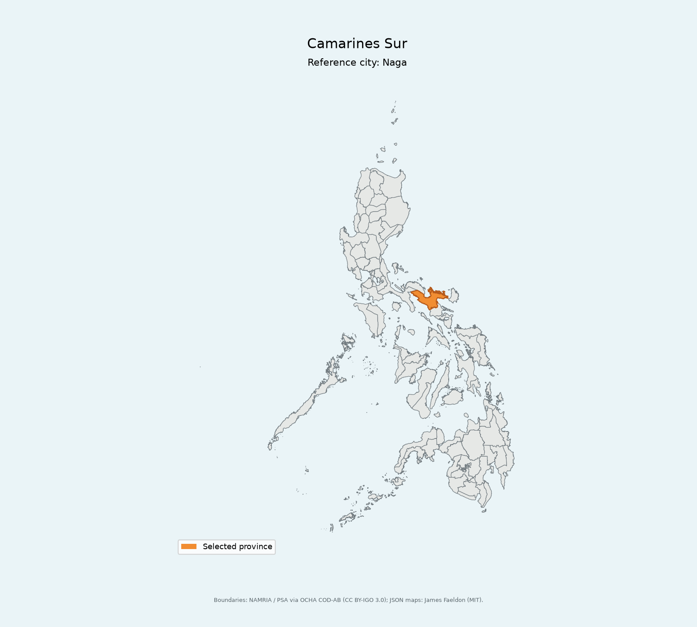

# 🌍 Geo Anki

[](https://www.python.org/)
[](https://docs.astral.sh/uv/)
[](https://pre-commit.com/)
[](https://docs.pytest.org/)
[](https://docs.astral.sh/ruff/)
[](https://gist.github.com/chrbrunk/ed1d7568fa8ea07f78781ddf965f603f#file-pytest-coverage-comment-json)

## 🗺️ Overview

Generate map-based [Anki](https://apps.ankiweb.net/) flashcards from real geographic
boundary data. Choose the
subdivisions you want to learn and export a deck with embedded maps. Cards show
the country and subdivision on the front, and a highlighted map on the back.

> [!IMPORTANT]
> **The following countries and subdivisions are supported:**
>
> - **Indonesia:** kabupaten (regencies) and kota (cities), below provinces.
> - **Philippines:** provinces.
>
> More countries are planned.

> [!NOTE]
> 🤖 **Built with Codex.** This repository was coded with OpenAI Codex.

## 🖼️ Example flashcards

### Indonesia

**Front:** `Indonesia: Muaro Jambi`

**Back:** `Kabupaten Muaro Jambi — Jambi`

Here, Jambi is the province, highlighted with a pale fill and bold outline.


### Philippines

**Front:** `Philippines: Camarines Sur`

**Back:** `Camarines Sur`

Camarines Sur is highlighted in orange on a map of the whole Philippines.



The map also names a reference city or town for the province.

## 🚀 Setup / Installation

Requires Python 3.12+ and [uv](https://docs.astral.sh/uv/).
For now, clone the repository and install its dependencies with uv:

```bash
git clone https://github.com/chrbrunk/geo-anki.git
cd geo-anki
uv sync --locked
```

Installation from PyPI via `pip` will be added later.

## 🃏 Usage

Generate a deck using the example Indonesia selection:

```bash
uv run geo_anki \
  --country indonesia \
  --targets examples/indonesia.txt \
  --output outputs/indonesia.apkg
```

`--targets` accepts your own UTF-8 text file with one subdivision name per line.
For Indonesia, use kabupaten/kota names without a province. For example:

```text
Kutai Kartanegara
Muaro Jambi
```

Each supported country has a sample selection of 10 subdivisions in
[examples/](examples/), with generated decks in
[examples/outputs/](examples/outputs/):

- **Indonesia:** [example input](examples/indonesia.txt) ·
  [generated deck](examples/outputs/indonesia.apkg)
- **Philippines:** [example input](examples/philippines.txt) ·
  [generated deck](examples/outputs/philippines.apkg)

Copy or edit an example input to choose your own subdivisions.

**🧭 Build your own selection: [targets/](targets/) contains the full lists,
with the exact dataset spellings to copy into your target file.**

- **Indonesia:** [kabupaten/kota names](targets/indonesia.txt)
- **Philippines:** [province names](targets/philippines.txt)

Boundary data downloads automatically and is cached locally. Unknown or ambiguous
names raise an error. The command produces an `.apkg` to import into Anki, PNG
maps, and a JSON manifest. Run `uv run geo_anki --help` for additional options.

## 📍 Data sources

Indonesia boundaries come from
[Indonesia-Geojson-2026](https://github.com/mashadinoor/Indonesia-Geojson-2026)
(MIT; mashadinoor and ardian28). Coverage may be incomplete or outdated.

Philippines boundaries come from
[philippines-json-maps](https://github.com/faeldon/philippines-json-maps)
(PSGC 3Q 2026; MIT maps by James Faeldon), based on NAMRIA and PSA boundaries via
[OCHA COD-AB](https://data.humdata.org/dataset/cod-ab-phl)
([CC BY-IGO 3.0](https://creativecommons.org/licenses/by/3.0/igo/)).

## 🛠️ Development

After setup, install the Git hooks once per checkout:

```bash
uv run pre-commit install
```

Hooks check configuration files, merge conflicts, filename case conflicts,
debugger statements, whitespace, Ruff linting and formatting, and ty types.
Commit messages must follow [Conventional Commits](https://www.conventionalcommits.org/),
for example `feat: add a country` or `fix: correct a map label`.
To run all configured checks across the repository manually:

```bash
uv run pre-commit run --all-files
```
