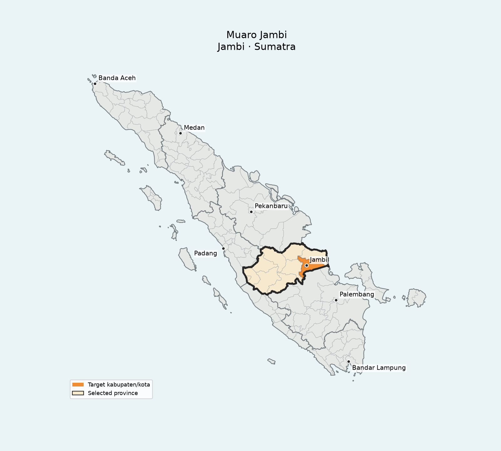
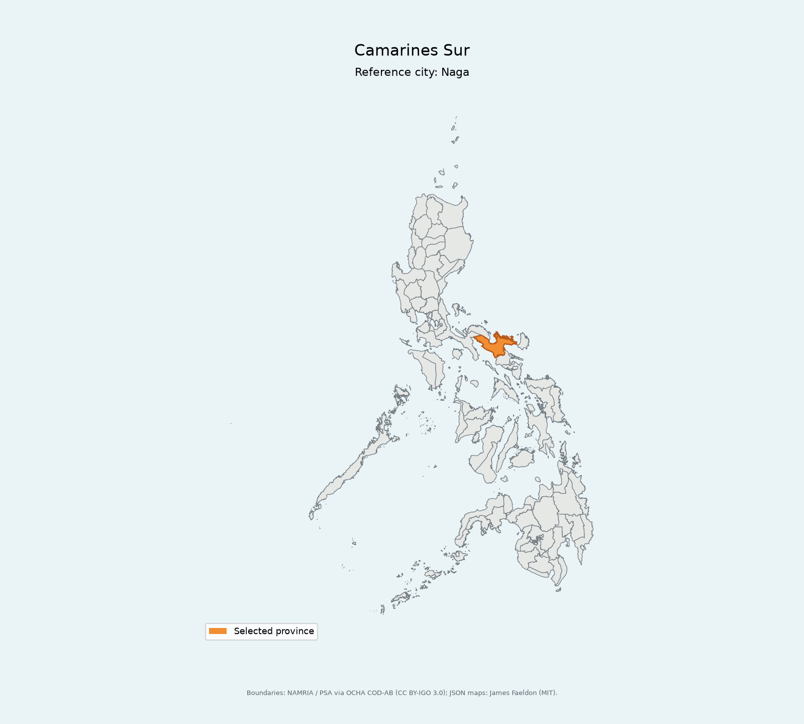
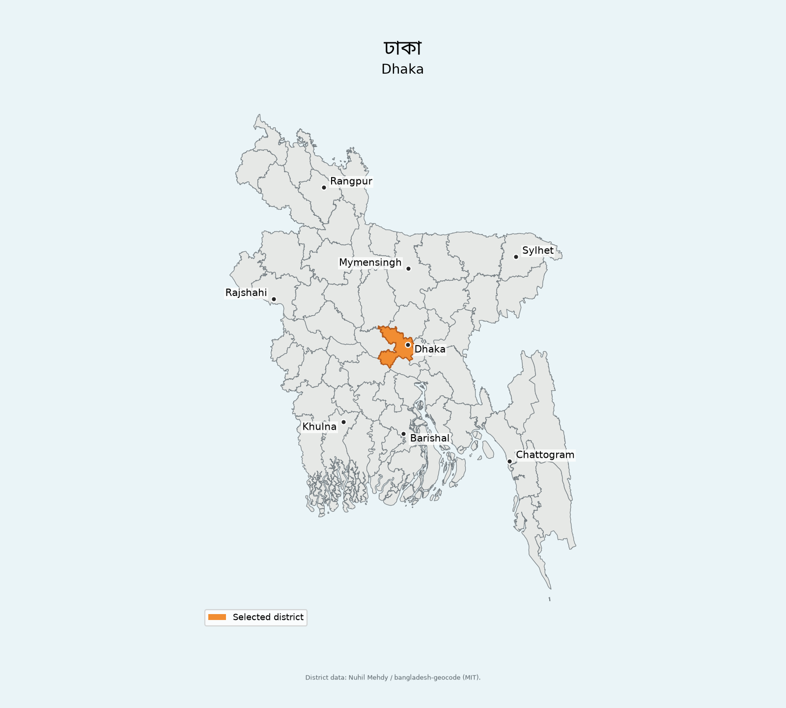
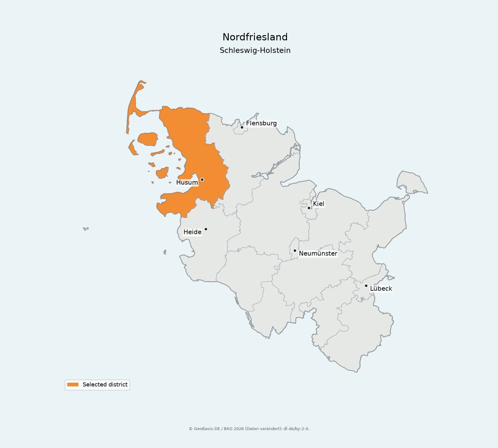
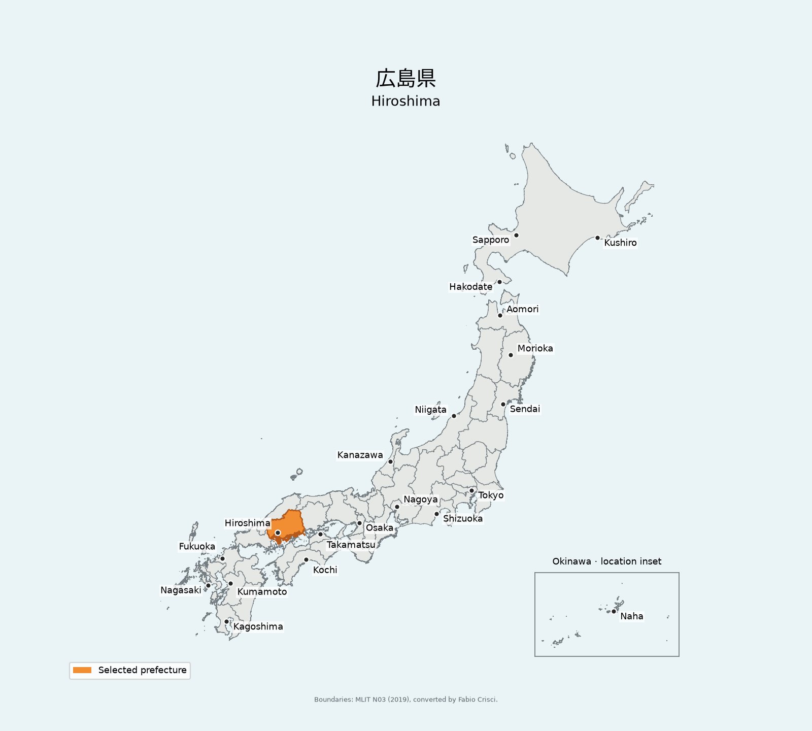

# 🌍 Geo Anki

[](https://www.python.org/)
[](https://pypi.org/project/geo-anki/)
[](https://docs.astral.sh/uv/)
[](https://pre-commit.com/)
[](https://docs.pytest.org/)
[](https://docs.astral.sh/ruff/)
[](https://gist.github.com/chrbrunk/ed1d7568fa8ea07f78781ddf965f603f#file-pytest-coverage-comment-json)

## 🗺️ Overview

Generate map-based [Anki](https://apps.ankiweb.net/) flashcards from real geographic
boundary data. Choose the
subdivisions you want to learn and export a deck with embedded maps. Cards show
the country and subdivision on the front, and a highlighted map on the back.

> [!IMPORTANT]
> **The following countries and subdivisions are supported:**
>
> - **Indonesia:** kabupaten (regencies) and kota (cities), below provinces.
> - **Philippines:** provinces.
> - **Bangladesh:** districts.
> - **Germany:** Landkreise (districts) and kreisfreie Städte (independent cities).
> - **Japan:** prefectures.
>
> More countries are planned.

> [!NOTE]
> 🤖 **Built with Codex.** This repository was coded with OpenAI Codex.

## 🚀 Getting started

Geo Anki is available on [PyPI](https://pypi.org/project/geo-anki/).

- To install Geo Anki, see [Installation](#-installation).
- To create a deck, see [Usage](#-usage).

## 🖼️ Example flashcards

### Indonesia

**Front:** `Indonesia: Muaro Jambi`

**Back:** `Kabupaten Muaro Jambi — Jambi`

Here, Jambi is the province, highlighted with a pale fill and bold outline.



### Philippines

**Front:** `Philippines: Camarines Sur`

**Back:** `Camarines Sur`

Camarines Sur is highlighted in orange on a map of the whole Philippines.



The map also names a reference city or town for the province.

### Bangladesh

**Front:** `Bangladesh: ঢাকা`

**Back:** `Dhaka`

Dhaka district is highlighted in orange on a map of the whole country, with
reference cities marked. Card fronts use the English country name followed by
the Bengali district name; map titles show both Bengali and English names.



### Germany

**Front:** `Germany: Nordfriesland`

**Back:** `Kreis Nordfriesland — Schleswig-Holstein`

The district is highlighted on a map of its entire Bundesland, with fixed
reference cities for that state.



### Japan

**Front:** `Japan: 広島県`

**Back:** `Hiroshima`

Hiroshima is highlighted on a map of Japan's main islands, with reference cities
and Okinawa in a boxed inset. Remote southern and southeastern islands are omitted.
Card fronts use Japanese prefecture names; map titles show Japanese and English.



## 📦 Installation

Requires Python 3.12+. Install the current release from PyPI:

```bash
pip install geo-anki
```

For development installation, see [Development](#-development).

## 🃏 Usage

Generate a deck using the example Indonesia selection:

```bash
geo_anki \
  --country indonesia \
  --targets examples/indonesia.txt \
  --output outputs/indonesia.apkg
```

`--targets` accepts your own UTF-8 text file with one subdivision name per line.
For Indonesia, use kabupaten/kota names without a province. For example:

```text
Kutai Kartanegara
Muaro Jambi
```

For Bangladesh, target files accept either Bengali or English district names.

For Japan, target files accept English or Japanese prefecture names (including
Japanese names without their suffix) and two-digit JIS codes. Card fronts use
the Japanese name, while backs show its English name and a map with reference
cities and a boxed Okinawa inset. Remote southern and southeastern islands are
omitted. Map titles show both names.

For Germany, a shared name such as `München` selects the Landkreis;
`München (kreisfreie Stadt)` selects the separate city. Official five-digit
district codes (AGS) are also accepted.

Each supported country has a sample selection of 10 subdivisions in
[examples/](examples/), with generated decks in
[examples/outputs/](examples/outputs/):

- **Indonesia:** [example input](examples/indonesia.txt) ·
  [generated deck](examples/outputs/indonesia.apkg)
- **Philippines:** [example input](examples/philippines.txt) ·
  [generated deck](examples/outputs/philippines.apkg)
- **Bangladesh:** [example input](examples/bangladesh.txt) ·
  [generated deck](examples/outputs/bangladesh.apkg)
- **Germany:** [example input](examples/germany.txt) ·
  [generated deck](examples/outputs/germany.apkg)
- **Japan:** [example input](examples/japan.txt) ·
  [generated deck](examples/outputs/japan.apkg)

Copy or edit an example input to choose your own subdivisions.

**🧭 Build your own selection: [targets/](targets/) contains the full lists,
with the exact dataset spellings to copy into your target file.**

- **Indonesia:** [kabupaten/kota names](targets/indonesia.txt)
- **Philippines:** [province names](targets/philippines.txt)
- **Bangladesh:** [district names](targets/bangladesh.txt)
- **Germany:** [district names](targets/germany.txt)
- **Japan:** [prefecture names](targets/japan.txt)

We recommend using an AI chatbot of your choice to filter a list from
[targets/](targets/) into the subset you want, for example, "only Java kabupaten
& kota". Save the resulting list as your `--targets` file.

Boundary data downloads automatically and is cached locally. Unknown or ambiguous
names raise an error. The command produces an `.apkg` to import into Anki, PNG
maps, and a JSON manifest. Run `geo_anki --help` for additional options.

## 📍 Data sources

Indonesia boundaries come from
[Indonesia-Geojson-2026](https://github.com/mashadinoor/Indonesia-Geojson-2026)
(MIT; mashadinoor and ardian28). Coverage may be incomplete or outdated.

Philippines boundaries come from
[philippines-json-maps](https://github.com/faeldon/philippines-json-maps)
(PSGC 3Q 2026; MIT maps by James Faeldon), based on NAMRIA and PSA boundaries via
[OCHA COD-AB](https://data.humdata.org/dataset/cod-ab-phl)
([CC BY-IGO 3.0](https://creativecommons.org/licenses/by/3.0/igo/)).

Bangladesh district boundaries and bilingual names come from
[bangladesh-geocode](https://github.com/nuhil/bangladesh-geocode)
(MIT; Nuhil Mehdy). Bengali text uses the bundled Noto Sans Bengali font
([SIL Open Font License 1.1](src/geo_anki/countries/bangladesh/fonts/OFL.txt)).

Germany uses BKG VG250 state and district boundaries (2026-01-01), converted to
GeoJSON by [Michael Kreil](https://github.com/MichaelKreil/verwaltungsgebiete).
© GeoBasis-DE / BKG 2026 (Daten verändert), licensed under
[Datenlizenz Deutschland – Namensnennung 2.0](https://www.govdata.de/dl-de/by-2-0).

Japan prefecture boundaries come from MLIT National Land Numerical Information
(N03, 2019-01-01), converted by Fabio Crisci in
[open-data-jp-prefectures-geojson](https://github.com/piuccio/open-data-jp-prefectures-geojson)
(MIT conversion; [MLIT source and terms](https://nlftp.mlit.go.jp/ksj/gml/datalist/KsjTmplt-N03-v2_3.html)).
Japanese text uses a renamed subset of Noto Sans CJK JP, bundled under the
[SIL Open Font License 1.1](src/geo_anki/countries/japan/fonts/GeoAnkiJapanese-LICENSE.txt).

## 💻 Development

Clone the repository and install its dependencies with
[uv](https://docs.astral.sh/uv/):

```bash
git clone https://github.com/chrbrunk/geo-anki.git
cd geo-anki
uv sync --locked
```

From a repository checkout, use `uv run geo_anki` instead of `geo_anki` for
the commands in [Usage](#-usage).

After setup, install the Git hooks once per checkout:

```bash
uv run pre-commit install
```

Hooks check configuration files, merge conflicts, filename case conflicts,
debugger statements, whitespace, Ruff linting and formatting, and ty types.
Commit messages must follow [Conventional Commits](https://www.conventionalcommits.org/),
for example `feat: add a country` or `fix: correct a map label`.
To run all configured checks across the repository manually:

```bash
uv run pre-commit run --all-files
```

Tox tests the built wheel with independently resolved dependencies on Python
3.12–3.15 in CI, without using `uv.lock`. To run locally (requires those Python
versions), use `uvx tox`; for just Python 3.12, use `uvx tox -e py312`.
